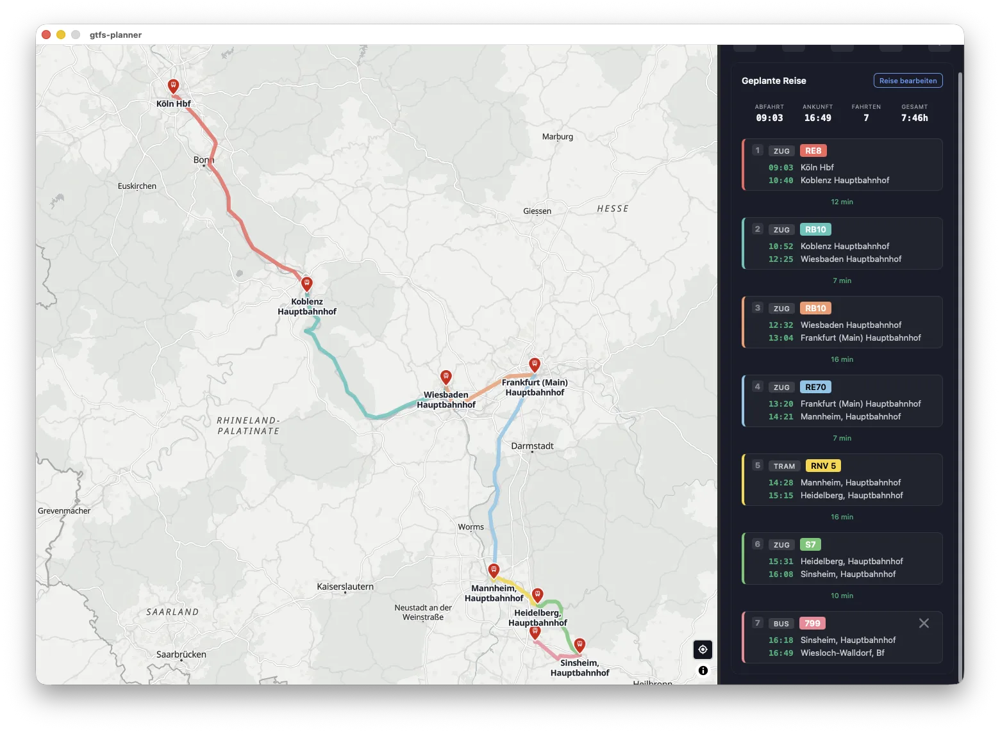

# GTFS Planner

A desktop application for visualizing and planning trips using GTFS (General Transit Feed Specification) public transit data. Built with Go, React, and MapLibre GL.



## Features

- **Interactive Map** - Browse transit stations on an OpenStreetMap-based map with MapLibre GL
- **Station Search** - Search for stations by name with keyboard navigation
- **Trip Planning** - View upcoming departures and plan multi-leg journeys
- **Route Visualization** - See route geometries with GTFS-defined colors
- **Trip Details** - View complete trip itineraries with all stops and times
- **Overnight Trip Handling** - Correctly handles GTFS times >= 24:00:00
- **Service Calendar** - Respects weekday rules and calendar exceptions

## Installation

Prebuilt downloads for each platform are attached to the
[latest release](https://github.com/klaustopher/gtfs-planner/releases/latest).
No GTFS data ships with the app — it is downloaded/imported from within the app on
first launch (see [GTFS Data](#gtfs-data)).

### macOS

#### Homebrew (recommended)

This repository doubles as its own Homebrew tap, so you can install and update
straight from `brew`:

```bash
brew tap klaustopher/gtfs-planner https://github.com/klaustopher/gtfs-planner
brew install --cask gtfs-planner
```

Later updates come with `brew upgrade --cask gtfs-planner`. The cask installs the
signed, notarized universal `.dmg` from the latest release.

#### Manual download

Download `gtfs-planner_<version>_macOS_universal.dmg`, open it and drag **GTFS
Planner** into your Applications folder. The app is signed and notarized, so it
opens normally without any Gatekeeper workaround. Runs natively on both Apple
Silicon and Intel.

### Linux

Builds are provided for both **amd64** (x86-64) and **arm64** (aarch64) — match
the `_amd64`/`_arm64` part of the filename to your CPU. The app needs GTK4 and
WebKitGTK 6.0 (Ubuntu 24.04+, Debian 13+, Fedora, Arch and other current
distros).

Install the runtime dependencies, extract and run:

```bash
# Ubuntu 24.04+ / Debian
sudo apt install libgtk-4-1 libwebkitgtk-6.0-4
# Fedora
sudo dnf install gtk4 webkitgtk6.0
# Arch
sudo pacman -S gtk4 webkitgtk-6.0

tar xzf gtfs-planner_*_linux_amd64.tar.gz
./gtfs-planner
```

If the window stays blank, see [Blank or white window](#blank-or-white-window).

### Windows

Download `gtfs-planner_<version>_windows_amd64_installer.exe` and run it.

The Windows build is **not code-signed**, so SmartScreen shows a *"Windows
protected your PC — unknown publisher"* warning. Click **More info → Run anyway**
to continue. The app is open source — if you prefer, you can
[build it yourself](#building-from-source).

## Prerequisites

- [Go](https://golang.org/) 1.24+
- [Node.js](https://nodejs.org/) 18+
- [Wails v3 CLI](https://v3.wails.io/quick-start/installation/)
- SQLite3
- Linux only: `libgtk-4-dev` and `libwebkitgtk-6.0-dev` (or your distro's equivalent)

Install the Wails CLI:

```bash
go install github.com/wailsapp/wails/v3/cmd/wails3@v3.0.0
```

## Building from source

### 1. Clone the Repository

```bash
git clone <repository-url>
cd gtfs-planner
```

### 2. Install Dependencies

```bash
# Install Go dependencies
go mod download

# Install frontend dependencies
cd frontend && npm install && cd ..
```

### 3. Run the Application

**Development mode:**

```bash
wails3 dev
```

This starts the Go backend with hot reload and the Vite dev server with HMR for the frontend.

**Build for production:**

```bash
wails3 build      # executable in bin/
wails3 package    # platform package: .app (macOS), NSIS installer (Windows)
```

## Usage

1. **Browse the Map** - Pan and zoom to find stations (stations appear at zoom level 8+)
2. **Select a Station** - Click a station marker or use the search box
3. **View Departures** - Upcoming trips appear in the sidebar
4. **Plan a Journey** - Click a trip to see details, then "board" to add to your journey
5. **Continue Planning** - After boarding, the app advances to your arrival time + 5 minutes

## GTFS Data

GTFS data management is built into the app — there is no separate CLI or config
file, and no Node.js is required for the import (it is a native Go importer).

When the database is missing or its schedule data has expired, the app opens a
setup dialog with two options:

- **Download from gtfs.de** — fetches the free German feed from an (editable)
  URL and imports it.
- **Open a local GTFS zip** — imports a zip you already have, e.g. the
  registration-gated [opendata-ÖPNV / DELFI](https://www.opendata-oepnv.de) feed.
  DELFI's detailed station hierarchy (platforms, track numbers) is normalized so
  it behaves like the gtfs.de model.

The first national import takes a few minutes and produces a multi-GB SQLite
database. You can see the database location and size — and delete it — under
**Settings**.

### Storage location

The database (`gtfs.sqlite`) and the downloaded feed live in a platform-specific
data directory:

- Linux: `$XDG_DATA_HOME/gtfs-planner` (or `~/.local/share/gtfs-planner`)
- macOS: `~/Library/Application Support/gtfs-planner`
- Windows: `%LocalAppData%\gtfs-planner`

## Linux notes

### Blank or white window

On some setups — notably NVIDIA drivers and certain Mesa/WebKitGTK combinations —
the window stays blank because of WebKitGTK's DMABUF renderer. Launch with it
disabled:

```bash
WEBKIT_DISABLE_DMABUF_RENDERER=1 ./gtfs-planner
```

To make it permanent, set the variable in a wrapper script or in the `Exec=` line
of a `.desktop` entry. For stubborn cases, `WEBKIT_DISABLE_COMPOSITING_MODE=1` is
an additional fallback.

## Development

For information about the project structure, architecture, and development guidelines, see [DEVELOPMENT.md](DEVELOPMENT.md).

## License

This project is licensed under the MIT License - see the [LICENSE](LICENSE) file for details.

## Author

Klaus Zanders
